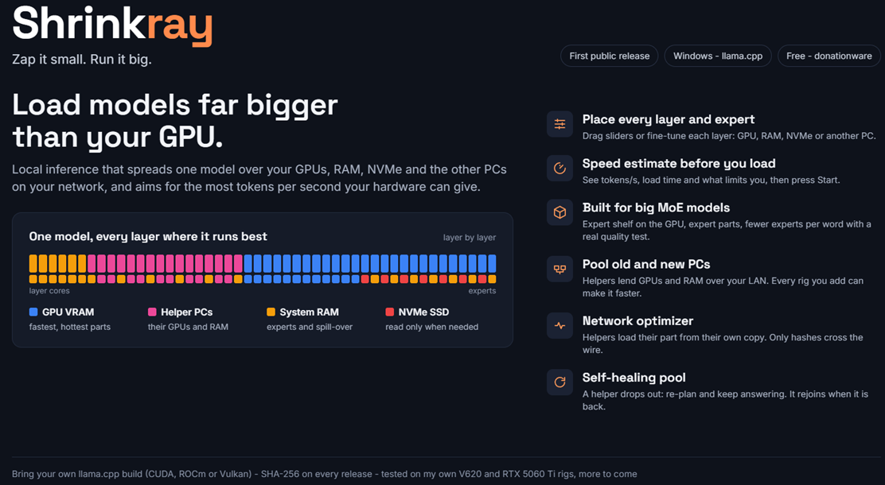

# Shrinkray

**Zap it small. Run it big.**

Shrinkray is a free Windows app for running **local AI models that are bigger than your GPU**. It is a front end for [llama.cpp](https://github.com/ggml-org/llama.cpp), built for **inference**. It spreads one model over your GPUs, system RAM, NVMe drive and other PCs on your network, and aims for the most tokens per second your hardware can give.

> **First public release.** I'm aiming to get this as close to perfect as I can, and your feedback helps. Bug reports and ideas are very welcome.



---

## What it can do

- **Load models far bigger than your VRAM.** Split one model across GPU VRAM, system RAM and NVMe. Drag sliders, or fine-tune every layer and its experts by hand.
- **See the speed before you load.** Estimated tokens/s, load time and what's holding you back, before you press Start.
- **Built for big MoE models** (DeepSeek, Qwen3 MoE, GLM...):
  - an **expert shelf** that keeps the most-used experts on your GPU
  - **expert parts** you can split between GPU and RAM
  - **fewer experts per word** for more speed, with a built-in **quality test** that shows what it costs on your model
  - a **warm-up** answer after loading, so your first question is fast
- **Pool your PCs, old and new.** Helper rigs lend their GPUs and RAM over your LAN. The **Fastest** planner puts every layer in the fastest place in the pool, and shows what each rig adds in words per second.
- **Network optimizer.** A helper with its own copy of the model loads only its part from its own drive. Only short checksums cross the network.
- **Self-healing pool.** If a helper drops out, the master re-plans and keeps answering. When the helper is back, it rejoins.
- **Master and helpers stay in step.** Helpers show exactly what the master gave them and what it is doing.
- **Safety checks before loading:** free RAM, the Windows page file, and a model read from a slow drive or network share.
- **OpenAI-compatible server** from llama.cpp's `llama-server`, so your usual chat apps and tools can connect.

## Requirements

- **Windows 10 or 11** (64-bit) with .NET Framework 4.5 or newer (built in on current Windows).
- **Your own llama.cpp build.** Download a Windows release from the [llama.cpp releases page](https://github.com/ggml-org/llama.cpp/releases): **CUDA** for NVIDIA, **Vulkan** for any GPU, **ROCm/HIP** for AMD. Use the **same build on every rig** in a pool. The MoE expert shelf needs a llama.cpp from October 2026 or newer.
- **AMD on ROCm:** download your own ROCm (TheRock) and point Shrinkray at it on Setup.
- A **GGUF** model.

Shrinkray doesn't download or install anything by itself. You bring llama.cpp, ROCm and your models.

## Getting started

1. Download `Shrinkray_v5.4.zip` from [Releases](../../releases) and check its SHA-256 (below).
2. Unzip it anywhere and run `Shrinkray.exe`. Windows may warn that it's unsigned: click **More info → Run anyway**.
3. **Setup:** pick your llama.cpp folder (and ROCm folder for AMD), press **Find GPUs**, then pick your model.
4. **Place it:** press **Auto place**, or drag the sliders. The speed estimate updates as you go.
5. **Run:** press **Start**, then **Open chat**.

### Pooling several PCs (PRO EXPERT)

1. Install the **same Shrinkray version and the same llama.cpp build** on every rig.
2. On the first rig, press **New key** on Expert and copy the pool key to every rig. The Key ID must match everywhere.
3. On each helper: set **This rig is: HELPER** and press **Allow in firewall**. Optionally set its **Model library** to a folder or NAS share that holds the model, so it loads its part from there.
4. On the master: set **MASTER**, press **Find rigs**, tick what each helper lends, then press **Connect / apply**.

Wired Ethernet is strongly recommended (10 GbE is best). Wi-Fi works but loads slowly. Keep pooling on your own network: llama.cpp's helper traffic is not encrypted.

## Download and checksums

Every release ships with `SHA256SUMS.txt`. Check the zip in PowerShell:

```powershell
Get-FileHash .\Shrinkray_v5.4.zip -Algorithm SHA256
```

| File | SHA-256 |
|---|---|
| `Shrinkray_v5.4.zip` | `5c029169b6bd50d5764346c88bbf98446a7adf22b35750a77a29eabc6307a769` |
| `Shrinkray.exe` (v5.4) | `3efb3faf8168b2adce897c4edb266b3f075e80715435031badf5ca504ff90d92` |

## Free and donationware

Everything you need to run big models is free. If Shrinkray helps you, please consider a Bitcoin donation to keep it going:

| Donation | Unlocks |
|---|---|
| **$1+** | **PRO**: no reminders, response settings and API mode |
| **$5+** | **PRO EXPERT**: multi-rig pooling and expert controls |

**BTC:** `bc1q99u9a5dgesqunes562aptespuxthzx0h3zxzzp`

Unlock in the app: **Donate**, then paste your transaction ID. Your unlock is stored encrypted for your Windows user on that PC.

## Reporting a problem

Open an [issue](../../issues) and include:

- your GPUs, RAM and drives (and each rig's, if pooling)
- the llama.cpp build (e.g. `b12532`, CUDA / Vulkan / ROCm)
- the model and quant
- what happened, plus the command line from the Run page
- `activity.log` from `%APPDATA%\Shrinkray` if you can

## Status

Tested on my own rigs (Radeon Pro V620s and RTX 5060 Tis) and on a test setup that simulates multi-rig pools. More testing, fixes and features are coming.

## License

Shrinkray is **freeware**: free to use and to share in its original, unmodified form. See [LICENSE](LICENSE). llama.cpp, ROCm and models are separate projects under their own licenses, and you download them yourself.

Provided as-is, with no warranty. Running large models works your hardware hard.
